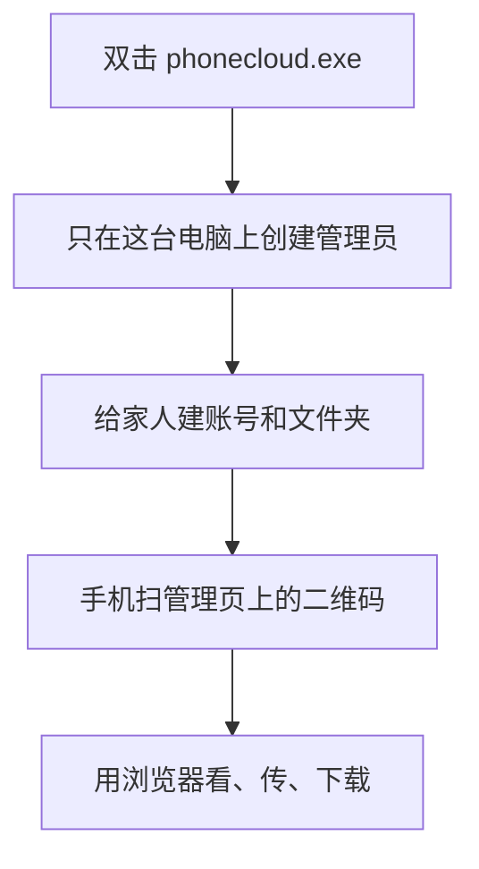
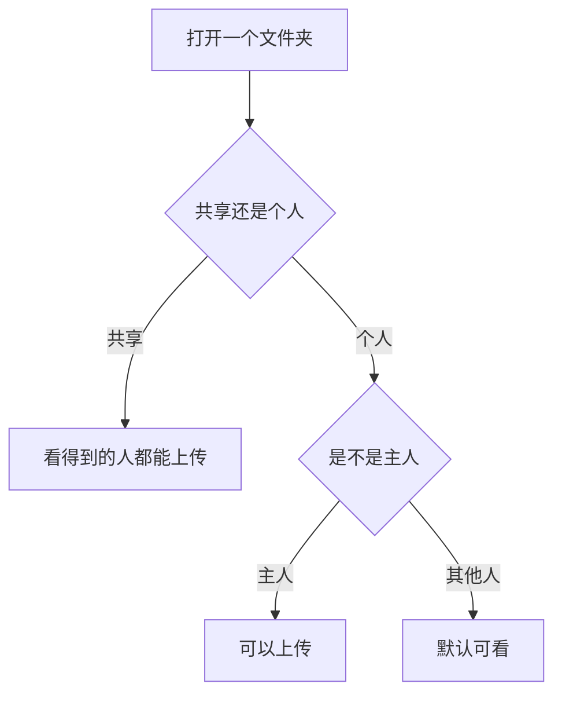

# PhoneCloud

把家里的 Windows 电脑当成局域网私有云。手机用浏览器看照片、放视频、上传和下载。不用装 App，文件留在这台电脑上。

> [!WARNING]
> 只支持 Windows。页面走局域网 HTTP，只给家里同一个 Wi-Fi 用。不要把端口 `8765` 映射到公网。

[下载 phonecloud.exe](https://github.com/A-Huu/PhoneCloud/releases/latest) · 直接使用看 [快速使用](快速使用.md)。本页留给要改程序或自己打包的人。


电脑保持开机。双击 `phonecloud.exe` 在后台启动并打开管理页；已经在运行就只打开页面。第一次运行会在旁边生成「重新启动」和「停止」。启动失败才会弹出提示。



## 文件夹

| 文件夹 | 位置 | 谁能上传 |
| --- | --- | --- |
| 共享 | 主目录下，和名字相同，如 `D:\PhoneCloud\家庭相册` | 看得到的人 |
| 个人 | `accounts\<账号>\<名字>` | 只有主人。其他人默认可看 |



在管理页「空间」里点「谁可以看」：保持所有人，或改成只让勾选的人看。主人始终看得到自己的个人文件夹。同名文件存成 `IMG_001_1.jpg`。删除的文件进电脑回收站。一次可以选多个文件，或选整个文件夹。

## 使用边界

- 管理员只能在这台电脑上创建。
- 上传中断后重新传，没有断点续传。
- 视频不转码。浏览器播不了的编码，下载后再看。
- 缩略图支持 JPEG、PNG、GIF、WebP、BMP。HEIC 不生成缩略图。
- 账号可以禁用。账号文件夹里没有文件时可以删除；里面还有文件时先清空。
- 电脑睡眠时手机暂时打不开，页面恢复后会自己重连。

## 主目录

```
D:\PhoneCloud\
  phonecloud.exe
  config.json              首次运行生成
  家庭相册\                 共享文件夹
  accounts\alice\          个人文件夹
  data\phonecloud.db       账号和权限
  data\thumbs\             缩略图，删了会重新生成
  data\logs\phonecloud.log
```

备份前先停止（双击「停止」，或 `phonecloud.exe stop`），再复制整个主目录。`data` 即使落在某个文件夹下面，也不会从网页打开。

## 从源码运行

需要 Python 3.10 或更高版本。

```powershell
python -m venv .venv
.\.venv\Scripts\python.exe -m pip install -r requirements-dev.txt
.\.venv\Scripts\python.exe run.py serve --home .devhome
.\.venv\Scripts\python.exe -m pytest -q
powershell -ExecutionPolicy Bypass -File build.ps1
```

`build.ps1` 先跑测试，再打出 `dist\phonecloud.exe`。加 `-SkipTests` 跳过测试。

| 路径 | 内容 |
| --- | --- |
| `phonecloud/` | 服务、命令行、内嵌网页 |
| `phonecloud/web/` | 用户页、管理页 |
| `快速使用.md` | 给直接使用的人 |
| `tests/` | 测试 |

运行产生的 `config.json`、`accounts/`、`data/`、`.devhome/`，以及 `build/`、`dist/`、虚拟环境，不进入仓库。

<details>
<summary>命令</summary>

主目录默认是 exe 所在文件夹，也可用 `--home` 或环境变量 `PHONECLOUD_HOME`。日志在 `data\logs\phonecloud.log`。移动 exe 之后，重新执行一次 `install-autostart`。

| 命令 | 作用 |
| --- | --- |
| `start [--port 8765] [--home 目录]` | 后台启动并打开管理页。已经在跑就只打开页面 |
| `start --no-browser` | 不打开浏览器 |
| `restart` | 先停止，再后台启动，并打开管理页 |
| `stop` | 停止 |
| `serve` | 当前窗口前台运行，Ctrl+C 停止 |
| `serve --background` | 后台运行，不打开浏览器。开机自启用这个 |
| `install-autostart` / `uninstall-autostart` | 登录 Windows 后自动启动 / 取消 |
| `reset-admin [--username admin]` | 重置管理员密码。账号不存在则创建 |

</details>

<details>
<summary>配置</summary>

改主目录里的 `config.json`，重启后生效。

| 项 | 默认 | 含义 |
| --- | --- | --- |
| `host` | `0.0.0.0` | 监听地址 |
| `port` | `8765` | 端口 |
| `max_upload_mb` | `5120` | 单个文件上限，5120 MB 即 5 GB |
| `min_free_mb` | `1024` | 磁盘至少保留的空闲空间，不够就拒绝上传 |
| `session_days` | `30` | 登录有效天数，使用中会续期 |
| `thumb_size` | `360` | 缩略图最长边（像素） |
| `access_log` | `false` | 是否把每个请求写进日志 |

</details>

<details>
<summary>手机打不开</summary>

先确认同一个 Wi-Fi，电脑没有睡眠。管理页上的二维码默认是无线网地址。

用管理员身份打开命令提示符，放行端口（改过端口就改下面的 `8765`）：

```
netsh advfirewall firewall add rule name="PhoneCloud" dir=in action=allow protocol=TCP localport=8765 profile=private
```

这条规则只对「专用网络」生效。把当前网络改成专用：

```
powershell -NoProfile -Command "Get-NetConnectionProfile | Set-NetConnectionProfile -NetworkCategory Private"
```

</details>

## 许可证

[MIT](LICENSE)。FastAPI、Pydantic、Pillow、segno 为 MIT；Starlette、uvicorn 为 BSD-3-Clause；python-multipart 为 Apache-2.0。
